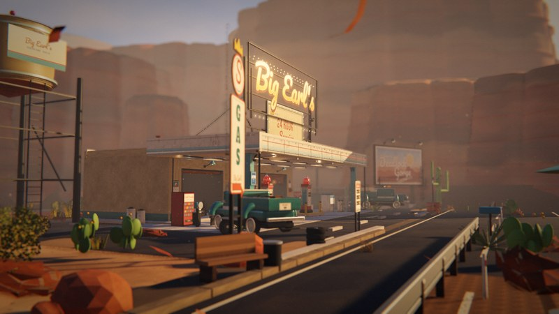
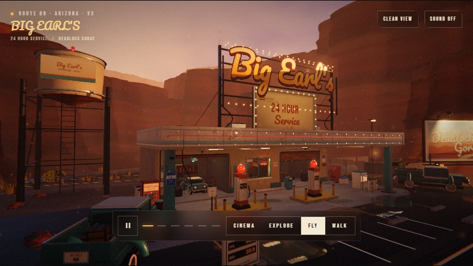
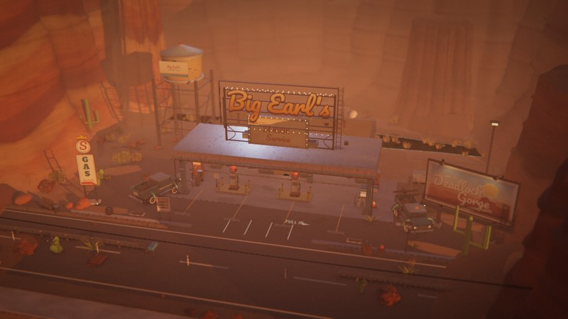

# Big Earl's — Deadlock Gorge

### An unofficial, fan-made recreation of the **Overwatch Route 66** map

**复刻《守望先锋》66 号地图中的 Big Earl's 24 小时加油站与 Deadlock Gorge 峡谷场景。**

**by DeepSeek-V4.1-flash 🐳**

**Three.js r170 · single scene · six cinema shots · 100% procedural**

[**Live preview**](https://cl0ud-99.github.io/big-earls/) — runs in the browser, nothing to install.

A real-time, from-scratch recreation of the **Overwatch Route 66** map's roadside stop — Big Earl's 24-hour gas station at Deadlock Gorge. Blue-hour light, wet asphalt, hand-painted signs, a water tower, a fenced work yard and a roadside picnic pull-out. No imported models, no texture files, no audio samples and no Blizzard assets — every surface, sign, mesa, prop and sound is generated procedurally at load time.




## The Overwatch Route 66 recreation

This project is a fan reconstruction of the **Route 66** payload map in **Overwatch** — specifically the Big Earl's 24-hour gas station at Deadlock Gorge and the canyon road around it. The target is the map's stylized realism, not a photoreal American gas station: chunky silhouettes, cream/teal/rust paint, hand-lettered signage, a low sun over red sandstone, and a foreground that reads as a playable space rather than a photograph.

The layout follows the map's roadside stop: the canopy and twin pump islands, the GAS pylon, the roof sign and the Welcome to Deadlock Gorge billboard; the low office and service bays behind; the water tower on the left shoulder; the fenced work yard; and the desert road with its guardrail and picnic pull-out. The scene is deliberately one map location — the detail budget goes into materials, lighting and set dressing instead of spreading across a larger world.

No Blizzard geometry, textures, audio or other game assets are used. Every mesh, sign, texture and sound in this repository is generated procedurally from code.

## Views

| | |
|---|---|
|  |  |

## What it is

A single-page Three.js r170 application with three ways to see the same location: a six-shot, 63-second PV timeline; an orbit/explore camera; and a free-fly / first-person walk mode with collisions, jumping and footsteps. The scene is deliberately one place — the Overwatch Route 66 stop at the edge of Deadlock Gorge — with the detail budget spent on materials, lighting and set dressing rather than map size.

`src/` is the whole program:

| File | Role |
| --- | --- |
| `main.js` | Boot, renderer, time-of-day system, post chain, frame loop |
| `cinema.js` | Six-shot timeline, transitions, HUD and title/end cards |
| `roam.js` | Free-fly camera + first-person controller, collision proxies, pointer lock |
| `sky.js` | GLSL sky dome, day/dusk/night palettes, sun / hemisphere / fill / rim lights, PMREM environment |
| `station.js` | Canopy, pumps, office, service bays, roof sign, practical lights |
| `cliffs.js` | Procedural mesa geometry, talus skirts, strata shading, boulders |
| `extras.js` | Water tower, chain-link work yard, picnic pull-out, guardrail, roadside signs, forecourt clutter, rocks |
| `post.js` | GTAO → bokeh DOF → bloom → grade (ACES, vignette, grain, chromatic aberration, sun glow) |
| `water.js` | Planar reflection + normal perturbation, fresnel, puddle/creek shading |
| `ground.js` | Road, forecourt, terrain colouring, puddles |
| `textures.js` / `signs.js` | Every canvas texture, sign, decal and licence plate |
| `props.js` / `env.js` | Pumps, vehicles, vegetation, utility poles, light registry |
| `audio.js` | Web Audio wind, canyon drone, neon hum, footsteps |
| `optimize.js` | Static mesh batching by material |

## Render pipeline

```
procedural sky ──> PMREM environment ──> PBR reflections
sun shadow (4096) ──┐
GTAO (half res) ────┼──> composite
planar water ───────┘
bokeh DOF ──> bloom ──> ACES + grade ──> letterbox
```

Details worth reading:

- **Wall and metal reflections** come from a PMREM built from the same procedural sky. The canopy fascia, chrome trim, pump bodies, truck paint and window glass all pick up the horizon and the sign glow; the sign is visible in the wet forecourt as a planar reflection.
- **The water is a real planar reflection**, not a screen-space approximation: a mirrored camera with an oblique near plane, normal-map perturbation, fresnel and distance fade. Puddles and the canyon creek share the same shader with different opacity and scale.
- **GTAO runs at half resolution** and is composited before DOF, so contact shadows in the service bay and under the canopy survive the bokeh pass.
- **The six shots are data** — each has its own duration, time-of-day range, camera start/end, FOV, focus distance and aperture. `jump()` can move to any shot for stills or review.
- **The first-person controller uses simple 2D AABBs and cylinders** for the building, columns, pumps, vehicles, guardrail, bench, water-tower legs and yard fence. It is intentionally cheap so the whole scene stays playable in one tab.
- **Static meshes are merged by material after construction**; instanced rocks and transparent surfaces are skipped. That keeps the cinema path at roughly 40–70 fps at 1600×900 on an RTX 2070 SUPER.

## The location

- **The station** — two pump islands under a riveted canopy, a lit office, two service bays, a roof sign on a steel frame, a GAS pylon and the Welcome to Deadlock Gorge billboard.
- **The water tower** — four legs, a painted tank and a red obstruction beacon, sitting behind the left shoulder of the station.
- **The work yard** — chain-link fence and open gate, wrecker with boom and hook, dumpster, propane tank, corrugated shed, tyre pile and a work light.
- **The picnic pull-out** — across the road: table, umbrella, string lights, kettle grill, cooler, vintage sedan and a saguaro.
- **The roadside** — W-beam guardrail, reflector posts, Route 66 mile marker, speed limit, LAST GAS 100 MILES board and a mailbox.
- **The desert** — rocks and green cactus only. The dense dry-grass and brown-shrub pass was removed on request; the ground is clean sand and asphalt.

## Audio

Entirely synthesised with Web Audio — no sample files:

- **Wind** — brown noise through a slow low-pass, with gusts.
- **Canyon drone** — two detuned low oscillators under a long filter sweep.
- **Neon hum** — 60 Hz and odd harmonics with a faint flicker.
- **Footsteps** — filtered noise bursts triggered by the walk controller.

Browsers block audio until the first gesture, so it starts when you click SOUND or capture the pointer.

## Running it

```bash
npm install
npm run build          # src/main.js -> dist/app.js
npm run standalone     # dist/app.js + style.css + fonts -> BigEarls-PV.html
npm run serve          # http://127.0.0.1:5178/
```

The committed playable build lives at `docs/index.html`: one HTML file with the CSS, the JS bundle and all three WOFF2 fonts inlined. It works from `file://` as well as Pages, with no server and no network access.

## Controls

| Input | Action |
| --- | --- |
| `Space` / play button | Play / pause the PV |
| `1` – `6` / `←` `→` | Jump between the six shots |
| `E` / EXPLORE | Orbit camera (drag to look, wheel to zoom) |
| `F` / FLY | Free camera: `WASD`, `Q` / `E` up/down, `Shift` boost; click to capture the pointer |
| `V` / WALK | First person: `WASD`, `Shift` run, `Space` jump; collisions with the station, props and yard |
| Click the canvas | Pointer Lock; `Esc` releases the cursor |
| `H` | Clean view (hide the HUD) |
| `S` | Ambient sound on/off (in roam, `S` is walk-back; use the SOUND button) |
| Time slider | Day → golden hour → dusk → night, in every mode |
| QUALITY | HIGH / ULTRA |
| End card | **FREE ROAM** drops straight into first person at night |

## Deployment

The site is served by GitHub Pages from `main` → `/docs`. `docs/index.html` is the single-file build; `docs/shots/` holds the README images. There is no build step on deploy — if the single file loads locally, it loads on Pages. The page is self-contained; every asset path inside it is a data URI.

## Notes on the look

The target is the **Overwatch Route 66** read: sun-bleached cream signage, teal steel, rust-red accents and a lot of warm bounce from the canyon walls, with chunky stylized silhouettes rather than photoreal grime. Materials are stylized PBR, not photoreal — clearcoat on the truck, slightly rough chrome, dusty concrete, painted wood.

The sun sits low and to the right, which puts the canopy edge and the pump bodies into rim light while the service bay stays in cool shade. The fill light is warm; the rim light is cold. At night the practicals take over: the canopy tubes, the office ceiling, the sign bulbs, the work-yard floodlight and the red tower beacon.

The water is the same idea: the reflection is sharp in the puddles but the normal map breaks it up just enough to read as standing water rather than a mirror. Red and blue fall off a little faster than green in the creek, so it goes olive rather than cyan.

No black cloud sprites, no cursor artefacts: the V3 build hides the OS cursor over the canvas, removes the old moon sprite and the flying-bird flock, and leaves the sky to the shader, stars and sun.

## Screenshots

`docs/shots/` holds the two views above, captured from the current V3 build. The working `shots/` directory is git-ignored — it contains the parameter sweeps and review captures.

## Disclaimer

Unofficial fan project. **Overwatch** and **Route 66** are trademarks of Blizzard Entertainment. This project is not affiliated with, endorsed by, or sponsored by Blizzard. No game assets are included; all geometry, textures, signs, lighting and audio are procedurally generated from code.

---

**Status:** V3 — cleaned vegetation pass, no sky artefacts, single-file build verified from `file://`.

**Model:** DeepSeek-V4.1-flash. **Stack:** Three.js r170 · esbuild · procedural canvas textures · Web Audio.
